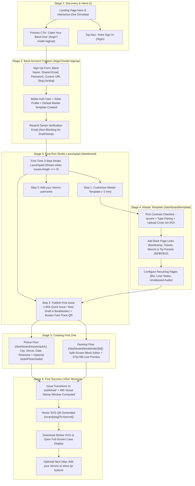

# Quire — Artist Product Design & End-to-End User Journey
**Status:** Confirmed & Locked In (All 3 core product design decisions finalized)
**Scope:** Landing Page (`/`) -> Band Account Sign-Up (`/login?mode=signup`) -> First-Time Studio Launchpad (`/dashboard`) -> Master Template Setup (`/dashboard/template`) -> Creating & Publishing First Zine (`/dashboard/issues/quick` & `/dashboard/bookbinder/[id]`)

> **Updated 2026-11-18 (ADR 0008):** tips moved from Stripe Connect Express to direct Venmo links. Wherever this document says "Connect Stripe Express", read **"Add your Venmo"**: the Artist enters a Venmo username in `/dashboard/settings` (requires a confirmed email), tip buttons appear, and changing or removing it needs password re-entry plus a Resend email confirmation link. Quire records Tip Taps only and takes no cut. Stripe code is dormant.

---

## 0. Confirmed & Locked-In Product Decisions

All three Artist User Journey product design decisions are **Confirmed & Locked In** with zero open ambiguity:

1. **Editable Clean Artist Slug on Sign-Up — Confirmed & Locked In:**
   - Landing Page CTAs route directly to `/login?mode=signup`.
   - On sign-up, `/login?mode=signup` shows a live, editable URL slug preview (`/a/band-name`) derived from the band name instead of appending a random 3-digit suffix.
   - Slugs are first-come, first-served with a live collision check and suggested alternatives if taken, since this slug is permanently baked into the Permanent Artist QR sticker.
   - Includes password reset via Resend (`/login/reset`) alongside Resend email verification.
2. **First-Time Artist 3-Step Studio Launchpad — Confirmed & Locked In:**
   - When a newly signed-up Artist visits `/dashboard` with `0` issues (`issues.length === 0`), `/dashboard` displays the **3-Step Studio Launchpad** above the fold instead of an empty gigs table:
     - **Step 1: Customize Master Template (`~2 min`)** — direct cover art upload, WCAG contrast-checked `--accent` against `--bg-void`, type pairing, tip presets, Back Page links, and editable/reorderable recurring pages.
     - **Step 2: Publish First Issue** — `<60 sec` Quick Issue phone flow or `"New Draft in Bookbinder"` desktop split-screen flow, plus a **Busker Fast-Track** to open/download their Permanent Artist QR immediately and display it in **Full-Screen Case Display** mode.
     - **Step 3: Add your Venmo** — enter a Venmo username in settings to show tip buttons on Cover, Issue pages and Back Page; changing or removing it later needs `SPEC.md` §6.4 password re-entry + Resend email confirmation (ADR 0008).
3. **Direct Media Uploads (Cloudflare R2 + Local Dev Fallback) — Confirmed & Locked In:**
   - Direct file uploads (`src/lib/server/storage/`, backed by Cloudflare R2 in production with automatic `/static/uploads` fallback in dev) are wired into the Master Template cover art field and into Quick Issue / Bookbinder photo and audio fields so artists can upload images and audio directly from their phone or laptop (in addition to URLs and embeds like `lite-youtube` and Bandcamp).

---

## 1. Product Design Principles (Applied to the Artist Side)

Following the core product design tenets and `docs/SPEC.md`:
1. **Radical Simplicity (60-Second Soundcheck Rule):** An artist standing in a dark venue before soundcheck must be able to go from opening Quire on their phone to holding a live, scannable Issue QR code in under 60 seconds.
2. **Immediate Value Before Administrative Friction:** Artists can sign up, customize their Master Template, and publish their first Issue immediately. Adding a Venmo username is deferred until they want tips (tip buttons stay cleanly hidden until one is set).
3. **Material Honesty & Constrained House Style:** Every Issue looks and feels like an authentic dark-glass Quire zine. Artists customize only three high-leverage identity tokens: **Cover Art**, **Contrast-Checked Accent Color (`--accent`)**, and **Typography Pairing** (`sans-serif`, `serif`, `mono`).
4. **Zero Dead-End Empty States:** A newly registered artist must never land on an empty table of gigs with `$0.00` metrics and no guidance. Empty states are onboarding launchpads.
5. **One Shared Band Login with Guardrails:** Because bandmates share a single email + password login, routine publishing is frictionless, while sensitive actions (changing or removing the Venmo username) require password re-entry plus a Resend email confirmation link.

---

## 2. End-to-End Artist User Journey Map

---

## 3. Step-by-Step UX Flow Breakdown & Production Audit

Every stage below follows the 6-part UX Flow framework (**Entry Point -> Context -> Action -> Feedback -> Outcome -> Next Step**) paired with a critique of the current implementation and exact production requirements.

### Stage 1: Landing Page (`/`)
- **1. Entry Point:** Touring band member or solo busker lands on `/` (often on mobile after seeing another band's QR sticker at a venue).
- **2. Context:** They want to know how Quire differs from a generic Linktree or Venmo QR sign, and they want to see what a fan actually experiences at a show.
- **3. Action:**
  - Interacts with the embedded `<ZineSimulator />` in the Hero section (swiping Cover -> Audio -> Setlist -> Wall -> Stub).
  - Toggles between *"For Touring Bands & Artists"* and *"For Fans & Music Lovers"*.
  - Clicks primary CTA: **"Claim Your Tour Zine"** or footer CTA **"Create Your Free Zine"**.
- **4. Feedback:** Immediate route transition to `/login?mode=signup` with the Sign-Up tab pre-selected.
- **5. Outcome:** The artist arrives directly at the Band Account Creation form without hunting for a sign-up toggle.
- **6. Next Step:** Complete the 4-field band registration form.

> [!IMPORTANT]
> **Production Gaps Identified on Landing Page (`src/routes/+page.svelte`):**
> - **[GAP 1.1] Primary CTAs open Sign-In instead of Sign-Up:** Both `"Claim Your Tour Zine"` (line 86) and `"Create Your Free Zine"` (line 791) currently link to `/login`, which defaults to `isSignUp = false` ("Artist Sign In"). They must link to `/login?mode=signup` and `/login` must read `url.searchParams.get('mode') === 'signup'`.
> - **[GAP 1.2] Demo Links Compete with Real Onboarding:** The top nav and hero feature `/demo` ("Demo Tour" / "Test Drive Artist Studio") which logs the visitor into the shared demo account. On a production landing page, live artist examples should link to public read-only issues (`/i/...` or `/a/the-neon-velvet`) rather than hijacking the user's auth session, or clearly label sandbox mode.

---

### Stage 2: Band Account Sign-Up (`/login?mode=signup`)
- **1. Entry Point:** Arrives at `/login?mode=signup` from Landing Page CTA.
- **2. Context:** One shared login per band (`SPEC.md` §3). The artist needs a permanent, clean URL slug (`/a/[slug]`) because their **Permanent Artist QR** encodes `/a/[slug]` for guitar cases and merch stickers.
- **3. Action:**
  - Enters **Band / Artist Name** (e.g., `Static Bloom`).
  - Sees live auto-generated, **editable Artist Handle / URL Slug** preview (`/a/static-bloom`) derived from the band name, with a first-come, first-served availability check and suggested alternatives if taken.
  - Enters **Band Shared Email** (`band@staticbloom.com`) and **Password** (min 8 chars).
  - Submits **"Create Band Account"**.
- **4. Feedback:**
  - Zod boundary validation (`src/lib/schemas/auth.ts`) validates name, slug uniqueness, email format, and password strength.
  - Better Auth creates the `user` (`accountType: 'artist'`), creates the `artist` row with default contrast-safe `--accent` (`#05D9E8`), default tip presets (`[3, 5, 10]`), and seeds one starter `template_page` ("About [Band Name]").
  - Resend dispatches the verification email in the background via `src/lib/server/email/index.ts`.
- **5. Outcome:** Session cookie is set and the artist is redirected to `/dashboard?onboarding=1`.
- **6. Next Step:** First-Time Studio Onboarding on `/dashboard`.

> [!WARNING]
> **Production Gaps Identified in Sign-Up (`src/routes/login/+page.server.ts` & `+page.svelte`):**
> - **[GAP 2.1] Random 3-Digit Suffix on Artist Slugs:** `login/+page.server.ts` line 118 currently forces `slug: "${baseSlug}-${Math.floor(100 + Math.random() * 900)}"` (producing `/a/static-bloom-742`). Per locked-in spec, the live, editable clean slug (`static-bloom`) must be used when available, with a collision check and suggested alternatives if taken (never silently appending a random 3-digit suffix).
> - **[GAP 2.2] Query Parameter `mode=signup` Ignored:** `login/+page.svelte` initializes `let isSignUp = $state(false)` without reading `data.initialMode === 'signup'`.
> - **[GAP 2.3] Password Reset Flow Missing in UI:** Resend password reset email templates and hooks are wired in `src/lib/server/auth.ts`, but `login/+page.svelte` has no `"Forgot password?"` link or reset route (`/login/reset`).

---

### Stage 3: First-Time Studio Launchpad (`/dashboard`)
- **1. Entry Point:** Redirected to `/dashboard` immediately after creating a band account (`issues.length === 0`).
- **2. Context:** The artist has zero published issues, zero tip taps, and no Venmo username. Dropping them into an empty data table creates cognitive friction.
- **3. Action:** Instead of an empty table, `/dashboard` renders the **3-Step Studio Launchpad** above the fold:
  1. **Step 1 — Customize Master Template (`~2 min`)**: Direct cover art upload (`src/lib/server/storage/`), WCAG contrast-checked `--accent` against `--bg-void`, type pairing, tip presets, Back Page links, and editable/reorderable recurring pages once; every future gig inherits them.
  2. **Step 2 — Publish First Issue (`<60 sec` Quick Issue or `"New Draft in Bookbinder"`)**: Enter tonight's City, Venue, and Date in Quick Issue to generate a scannable Issue QR, or click **`"New Draft in Bookbinder"`** for the desktop split-screen editor. Includes a **Busker Fast-Track** callout to open/download their Permanent Artist QR (`/a/[slug]`) immediately and launch **Full-Screen Case Display** mode.
  3. **Step 3 — Add your Venmo**: Enter a Venmo username so tip buttons appear on Cover, Issue pages, and Back Page (changing or removing it later needs `SPEC.md` §6.4 password re-entry + Resend email confirmation, ADR 0008).
- **4. Feedback:** Each completed step shows a `[COMPLETED]` status badge.
- **5. Outcome:** The artist immediately understands the relationship between their **Master Template**, **Gig Issues**, **Permanent Artist QR / Back Page**, and **Venmo tips**.
- **6. Next Step:** Click **Customize Master Template** (desktop/pre-tour), **Publish Quick Issue** / **New Draft in Bookbinder**, or **Full-Screen Case Display** (buskers).

> [!IMPORTANT]
> **Production Gaps Identified on Dashboard (`src/routes/dashboard/+page.svelte`):**
> - **[GAP 3.1] No Empty State for First-Time Artists:** When `data.issues.length === 0`, the dashboard renders an empty `<table>` with only the `General (Back Page)` row and an empty moderation box (`0 notes`), violating the product-design empty state principle.
> - **[GAP 3.2] No Direct "Create Draft in Bookbinder" Action:** The dashboard header only links to `/dashboard/issues/quick` (`+ Publish Quick Issue`). Desktop users who want to build their first Issue block-by-block in the split-screen Bookbinder cannot start a new Issue in Bookbinder directly from the dashboard.

---

### Stage 4: Setting the House Identity — Master Template (`/dashboard/template`)
- **1. Entry Point:** Artist clicks **"Master Template"** in the top nav or onboarding checklist.
- **2. Context:** Everything configured here (Cover Art, `--accent`, Type Pairing, Tip Presets, Back Page Links, and Recurring Pages) is automatically injected into every Issue they ever publish (`SPEC.md` §6.1).
- **3. Action:**
  - **Cover Art:** Uploads an image file directly from phone or laptop (`src/lib/server/storage/`, backed by Cloudflare R2 with `/static/uploads` local dev fallback) or provides an image URL, with an instant thumbnail preview.
  - **Accent Color (`--accent`):** Picks an accent color with **live WCAG contrast verification** against `--bg-void` (`#090710`) so text and badges remain legible (`SPEC.md` §6.1: *"accent color (contrast-checked)"*).
  - **Typography Pairing:** Selects between `Inter (Clean Studio Sans)`, `Georgia (Editorial Print Serif)`, or `JetBrains Mono (DIY Tape Label)`.
  - **1-Tap Tip Presets:** Sets 3 preset dollar amounts between $2 and $500 USD (default $3 / $5 / $10).
  - **Back Page Links:** Adds label + URL pairs (Tickets, Bandcamp, Merch, Instagram).
  - **Recurring Pages:** Adds, edits, and reorders pages that appear in every Issue (Bio, Gear / Liner Notes, Audio with direct audio upload or Bandcamp/embed URL, `lite-youtube` / Bandcamp Video Facade, Setlist).
- **4. Feedback:** Live CSS custom property `--accent` updates the studio shell immediately; saving shows confirmation and updates all connected Issues.
- **5. Outcome:** The band's reusable zine architecture is locked in. Future issues require only city, venue, and date.
- **6. Next Step:** Proceed to **"Publish First Issue"** (`/dashboard/issues/quick`).

> [!WARNING]
> **Production Gaps Identified in Master Template (`src/routes/dashboard/template/+page.svelte`):**
> - **[GAP 4.1] Raw Image URL Input Only (No File Upload):** `coverArtUrl` is a plain `<input type="url">` asking for an Unsplash URL. Production requires a real file upload endpoint/action backed by our R2/local storage service (`src/lib/server/storage/`).
> - **[GAP 4.2] Missing Contrast Check on `--accent`:** `SPEC.md` §6.1 mandates that `--accent` is contrast-checked. If an artist selects `#111111` in the `<input type="color">`, badges and borders become invisible on `#090710`. We need a pure domain helper in `src/lib/domain/` that enforces minimum WCAG luminance/contrast against `--bg-void` and warns/clamps in the UI.
> - **[GAP 4.3] Audio Recurring Page Missing Audio Upload / Embed Source:** Adding an `audio` recurring page currently asks for `title`, `duration`, and `body`, but has **no field for direct audio file upload (`src/lib/server/storage/`) or Bandcamp/SoundCloud embed URL**!
> - **[GAP 4.4] Recurring Pages Cannot Be Edited or Reordered:** Currently you can only add or delete a recurring template page, not edit its text or move it up/down.

---

### Stage 5: Creating the First Zine (Two Purpose-Built Workflows)

`SPEC.md` §6.2 defines two distinct creation tools for two different physical contexts, and **either tool can open an Issue made in the other**:

#### Path A: The 60-Second Phone Flow (`/dashboard/issues/quick`)
*Designed for a tired artist in the van or at soundcheck on a mobile screen.*
- **1. Entry Point:** Taps **"+ Publish Quick Issue"** from `/dashboard` or top nav.
- **2. Context:** Needs tonight's zine and QR code live in under a minute.
- **3. Action:**
  - Optional 1-tap shortcut: **"Duplicate Last Issue"** (pre-fills venue, timezone, cover note, and setlist from the previous stop, clearing only city and date per `SPEC.md` §6.2).
  - Enters required fields: **City** (`Philadelphia`), **Venue or Spot** (`Johnny Brenda's`), and **Gig Date** (`2026-11-17`).
  - **Venue Time Zone** auto-detects from the artist's browser (`Intl.DateTimeFormat().resolvedOptions().timeZone`) or city, with manual override.
  - Optional quick additions:
    - **One-Line Cover Note** (*"Playing till 10pm — first 20 at merch get a poster"*).
    - **Tonight's Photo** (1-tap phone camera/library direct upload via `src/lib/server/storage/` R2/local fallback or URL).
    - **Tonight's Setlist** (newline or comma-separated songs).
  - Taps **"Publish Issue & Generate Venue QR"**.
- **4. Feedback:** Server computes the 48-hour local Stamp Window (`00:00:00` on gig date through `23:59:59` the next day in the venue's timezone), generates a cryptographic `secretKey`, creates the `published` Issue and bespoke pages, and renders the **Live Sticker & Full-Screen Case Display**.

#### Path B: The Desktop Bookbinder (`/dashboard/bookbinder/[id]`)
*Designed for building and polishing Issues block-by-block on a laptop with a live 375x780 mobile preview.*
- **1. Entry Point:** Clicks **"Polish in Bookbinder"** after Quick Issue, or **"Edit Zine"** / **"New Draft in Bookbinder"** from `/dashboard`.
- **2. Context:** The artist wants fine-grained control over page order, road stories, photo spreads, audio drops (direct audio upload or embed URL), or video embeds (`lite-youtube` / compact Bandcamp) while seeing the exact horizontal scroll-snap mobile reader update in real time.
- **3. Action:**
  - Edits **Page 1: Cover & Issue Lifecycle** (`draft` -> `published` -> `cancelled` | `archived`, enforcing the strict Issue Lifecycle FSM where issues are never deleted and cannot transition back to `draft`).
  - Adds, edits, and reorders **Bespoke Gig Pages** (`text`, `setlist`, `photo` via direct R2/local upload or URL, `audio` via direct R2/local upload or embed URL, `video` via `lite-youtube` / Bandcamp).
  - Previews the complete page sequence in the sticky right-hand phone frame:
    `Cover -> Bespoke Pages -> Master Template Recurring Pages -> Issue Wall -> Endpaper (Save or Stamp)`.
- **4. Feedback:** Every save refreshes the live mobile reader iframe and updates the downloadable QR sticker.

> [!WARNING]
> **Production Gaps Identified in Zine Creation (`quick/+page.svelte` & `bookbinder/[id]/+page.svelte`):**
> - **[GAP 5.1] Quick Issue Missing Optional Photo Upload:** `SPEC.md` §6.2 states Quick Issue supports *"Optional: Cover note, photo, setlist, and 1–2 bespoke pages"*. Currently `quick/+page.svelte` only has `coverNote` and `setlistSongs` (no direct photo upload via `src/lib/server/storage/`).
> - **[GAP 5.2] Audio & Video Page Blocks Missing Direct Uploads / Media URLs:** In `bookbinder/[id]/+page.svelte`, adding or editing an `audio` page only collects `title`, `duration`, and `body` (no direct audio upload via `src/lib/server/storage/` or `audioUrl`), and `video` (`lite-youtube` / Bandcamp facade per `SPEC.md` §5.2) is not in the Bookbinder page type selector.
> - **[GAP 5.3] Full-Screen Phone Stage Mode Missing:** `SPEC.md` §4 specifies: *"Publishing generates a downloadable SVG QR code for stickers. It can also be shown full-screen on a phone (propped up next to a busker's case)."* Both Quick Issue and Dashboard QR views need a **"Full-Screen Case Display"** toggle that hides navigation chrome and maximizes the high-contrast QR badge for scanning from a distance.
> - **[GAP 5.4, superseded by ADR 0008: settings now take a Venmo username] Settings Page Uses Mock Stripe Inputs Instead of Real Stripe Connect Onboarding:** `src/routes/dashboard/settings/+page.svelte` still has a manual text box (`stripeAccountId = 'acct_demo_neon_velvet'`) and a checkbox (`Enable Stripe Connect Express Payouts`) instead of a real **"Connect with Stripe Express"** action that calls `createConnectedAccount` / `createAccountOnboardingLink` from `src/lib/server/payments/stripe.ts` and requires password + Resend email confirmation (`payout_change_tokens`) when changing an existing payout account (`SPEC.md` §6.4).

---

## 4. Summary Matrix: Production Readiness Action Plan for the Artist Side

| Journey Stage | Route(s) | Current State | Production Upgrade Required |
|---|---|---|---|
| **1. Landing -> Sign-Up** | `/`, `/login` | Primary CTAs open Sign-In (`isSignUp = false`); `/demo` links in primary nav | Route primary CTAs to `/login?mode=signup`; initialize `isSignUp` from query param; add Forgot Password flow |
| **2. Band Registration** | `/login` (`?/signup`) | Appends random `-123` suffix to every artist slug | Allow custom/clean artist slug (`/a/band-name`) with collision check; show email verification status |
| **3. First-Run Studio** | `/dashboard` | Renders empty table when `issues.length === 0` | Add **3-Step Studio Launchpad** above the fold (Master Template, Quick Issue / `"New Draft in Bookbinder"` + Busker Fast-Track to Permanent Artist QR & Full-Screen Case Display, Add your Venmo) |
| **4. Master Template** | `/dashboard/template` | URL-only cover art; unchecked color picker; audio page lacks upload/URL; no page editing/reordering | Add R2/local image & audio uploads (`src/lib/server/storage/`), WCAG contrast checker for `--accent` against `--bg-void`, audio/video URL fields, and recurring page edit/reorder actions |
| **5. Quick Issue & Bookbinder** | `/dashboard/issues/quick`, `/dashboard/bookbinder/[id]` | Quick Issue lacks photo upload; Bookbinder lacks audio upload/`audioUrl` and `video` embed block; no Full-Screen Case Display mode | Add optional R2/local photo upload to Quick Issue, direct audio/photo upload + `audioUrl` + `video` (`lite-youtube`/Bandcamp) blocks to Bookbinder, auto-detected timezone, and **Full-Screen Case Display** mode |
| **6. Venmo & Account Safety** | `/dashboard/settings` | Stripe Connect settings (now dormant) | Venmo username field with "Test your link" + SPEC §6.4 password re-entry & Resend email confirmation for changes (ADR 0008) |
